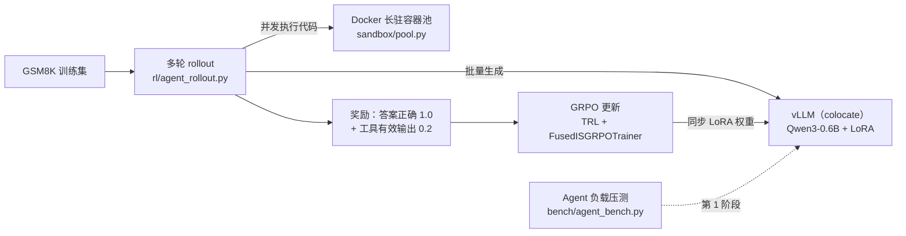

# Agent RL 训练基础设施

面向**工具调用 Agent** 的推理与强化学习训练系统：从 Agent 负载下的 vLLM 推理压测，到执行模型代码的 Docker 沙箱，再到多轮工具调用的 GRPO 训练和训练循环优化。全部实验在一张 RTX 3080 Ti（12GB）上完成，未租用云 GPU。

每个结论都配有对照实验，每个数字都注明了测量条件。完整实验记录（含失败的尝试和更正）见 [ENV_NOTES.md](ENV_NOTES.md)。

## 架构



## 主要结果

| 阶段 | 做了什么 | 关键结果 |
|---|---|---|
| 1 推理 | Agent 负载压测 → 定位尾延迟根因 → 会话级准入控制 | 过载下前缀缓存命中率 76% → 92%，会话完成时间 P50 −32%，有效吞吐 +18%（RTX 3080 Ti；H100 上命中率同样恢复，但吞吐和完成时间变差，见"云上复测"） |
| 2 沙箱 | Docker 代码沙箱，实测推翻初始设计后重构 | 吞吐约 13 → 96 次/秒（约 7 倍），15 项安全验收测试全部通过 |
| 3 训练 | 多轮工具调用 rollout + GRPO | GSM8K 完整测试集准确率约 45% → 69%，工具调用有效率 70% → 95% |
| 3.5 优化 | 去掉训练循环里的冗余前向 | 每步非 rollout 耗时 −18.5%，对数概率逐位等价，准确率均值不变 |

### 第 1 阶段：Agent 负载下的推理性能

Agent 负载与普通聊天不同：多轮对话、共享很长的系统提示词与工具定义、每轮之间要等工具返回。压测工具 `bench/agent_bench.py` 按 token 精确构造请求（直接发送 token id，并把模型真实生成的 token 接回上下文），支持闭环（固定并发）和开环（泊松到达）两种模式。

- **拐点在 16–32 并发**：KV Cache 占满后，命中率从 92% 降到 79%，TTFT P99 从 71 ms 涨到 1652 ms，吞吐不再增长（Qwen3-0.6B，KV 7.56 GiB，每档 ≥256 个请求）。
- **前缀缓存的收益是 Agent 负载特有的**：32 并发下，Agent 负载开启前缀缓存后吞吐 +73%（5.73 → 9.91 请求/秒）、TTFT P50 从 1257 ms 降到 61 ms；同等计算量、但没有共享前缀的 chat 对照组开不开都一样。（以上为 RTX 3080 Ti 数据。H100 PCIe 上同样条件下收益只有 +13%：prefill 越便宜，省掉 prefill 的价值越小；见下方"云上复测"）
- **用对照实验证明因果**：固定并发，只改 KV 容量（`--kv-cache-memory-bytes`）：

  | KV 容量 | token 数 | 命中率 | TTFT P99 |
  |---|---|---|---|
  | 3.0 GiB | 28,080 | 59.8% | 4268 ms |
  | 5.0 GiB | 46,800 | 65.5% | 2250 ms |
  | 7.56 GiB | 70,768 | 79.6% | 1739 ms |
  | 8.44 GiB | 79,008 | 84.5% | 927 ms |

  按工作集模型估算，32 个会话的峰值工作集约 9.8 万 token，大于本机能分配的 KV 容量，所以命中率达不到 92% 的理论上限。
- **会话级准入控制**（在压测客户端内实现的原型）：同时活跃的会话数不超过 K，新会话在闸门排队，避免等工具的会话缓存被挤掉。K = 24 由工作集模型算出。开环、每秒 2 个会话到达（已超过系统容量），两次运行取平均：

  | 指标 | 无控制 | 闸门 K=24 | vLLM `max-num-seqs`=12 |
  |---|---|---|---|
  | 前缀缓存命中率 | 76% | **92%** | 78% |
  | 会话完成时间 P50（含闸门排队） | 37.0 s | **25.2 s** | 33.6 s |
  | 有效吞吐（TTFT ≤ 500 ms 的请求/秒） | 6.72 | **7.96** | 2.93 |
  | 第 1–7 轮 TTFT P99 | 2142 ms | **91 ms** | 5288 ms |
  | 每轮都 ≤ 500 ms 的会话占比 | **39.6%** | 27.1% | 19.3% |

  代价：新会话首轮要排队（P50 5.6 s），按"每一轮都达标"的严格标准，闸门不如不控制。vLLM 的请求级限流在 8 / 12 / 16 / 默认值下命中率都停在 75–78%：它限制的是正在计算的请求，管不到等工具会话占着的缓存。（本节数字均为 RTX 3080 Ti。）

### 第 2 阶段：代码执行沙箱

`sandbox/pool.py`：禁止联网、只读根文件系统、内存 512 MB、1 核 CPU、最多 64 个进程、非 root、去掉全部 capabilities，宿主侧强制超时，输出 4 KB 截断。

- **初始设计被实测推翻**：一次性预热容器池（每段代码独占一个新容器）的吞吐上限等于容器创建 + 销毁的速率，约 13–14 次/秒，而 CPU 只用了 14–20%，瓶颈在 dockerd 的串行操作。
- **重构为长驻容器池 + 污染即回收**：容器复用，每次执行在 fork 出的子进程里跑，结束后杀光遗留进程、清空 /tmp；出现超时、输出超限或被 OOM 杀掉时立即换新容器。

  | 方案（32 并发） | 吞吐 | P50 延迟 |
  |---|---|---|
  | 宿主子进程（无隔离） | 775 次/秒 | 38 ms |
  | 冷启动（每次 `docker run`） | 13 次/秒 | 2383 ms |
  | 一次性预热池 | 14 次/秒 | 2398 ms |
  | **长驻容器池** | **96 次/秒** | **318 ms** |

- **15 项安全验收测试**（`sandbox/security_test.py`）：死循环、进程炸弹、内存炸弹、联网、写系统目录、读宿主文件、超大输出、非 root，以及 4 项执行间串扰测试（池大小设为 1，强制落在同一容器）。三种模式全部通过。
- **I/O 背压死锁**：输出超限时，若先停止读取再删除容器，dockerd 写输出会阻塞，`docker rm -f` 随之卡住（实测 3.5 分钟）。改为先杀本地客户端再删容器后，降到 0.29 秒。
- **适用范围**：Docker 默认的 runc 与宿主共享内核，只适合执行自家模型生成的代码（半可信），不适合陌生用户提交的任意代码。

### 第 3 阶段：GRPO 训练工具调用 Agent

- **rollout**（`rl/agent_rollout.py`，接入 TRL 的 `rollout_func`）：vLLM 批量生成 → 把写了 ` ```python ` 的回答并发送进沙箱执行 → 执行结果作为一轮 user 消息接回（`env_mask=0`，不计入损失）→ 最多 4 轮。
- **奖励**：答案正确 1.0；至少一次工具调用拿到**有效输出**（成功且非空）再加 0.2，每题最多一次。按有效输出判定而不是按退出码，避免奖励"忘写 print"。
- **训练**：Qwen3-0.6B + LoRA（r=16），每步 8 题 × 8 个采样，300 步，用时 129 分钟，显存峰值 10.3 GB。
- **评测**（`rl/eval_rollout.py`）：用和训练相同的 rollout 代码，贪心解码，GSM8K 完整测试集 1319 题。同一模型重复评测的波动约 1 个百分点。

  | 提示词 | 训练前 | 训练后 | 训练后工具使用率 |
  |---|---|---|---|
  | 强制用工具（训练时的设置） | 44.6–46.4% | 68.4–69.1% | 97% |
  | 可选用工具 | 48.0% | 69.1% | 29%（训练前 0.2%） |
  | 不提工具 | 48.4% | 68.7% | 0% |

  不给工具时同样从 48% 提升到 69%，所以**提升主要来自推理能力，而不是工具本身**。工具使用能力确实学会了（强制模式下工具调用有效率从 70% 到 95%），但 GSM8K 的算术太简单，工具对准确率的帮助很小。代价是每题生成的 token 数约翻倍（204 → 404）。
- **观察到的行为**：部分训练运行中，模型会在看到真实执行结果之前先写一个"Output:"块猜测输出（伪造观测）。它出现与否取决于训练轨迹（同一配置不同种子分别为 67% 和 4.8%），对准确率没有明显影响，因为只按看到真实结果后的最后一轮作答。

### 第 3.5 阶段：去掉训练循环里的冗余前向

分段计时（`rl/train_grpo.py --profile`，每段前后同步 GPU）：

| 每步 21.77 s 的组成 | 耗时 | 占比 |
|---|---|---|
| rollout（生成 + 执行代码） | 5.16 s | 23.7% |
| **旧 logprob 重算（vLLM 重要性采样纠偏用）** | **3.15 s** | **14.5%** |
| 损失前向 | 3.15 s | 14.5% |
| 反向（含梯度检查点的前向重算） | 10.07 s | 46.3% |
| 权重同步、算奖励、优化器等 | ≈0.24 s | ≈1% |

在"每批数据只训练一轮、并在一次优化步内用完"的前提下，"旧 logprob"与损失前向算出的 logprob 完全相同（TRL 源码注释也承认这一点）。`rl/fused_is.py` 的 `FusedISGRPOTrainer` 在不修改 TRL 源码的前提下，把重要性采样比值挪到损失阶段计算，复用损失前向的结果：

- **数值等价**：40 个微批次中，两种做法的 logprob 逐位相同，比值最大差异 2.4×10⁻⁷；
- **提速**：每步非 rollout 耗时 18.82 → 15.34 s（−18.5%，两个随机种子的平均）；
- **训练质量**：两种配置各用两个随机种子训练 200 步，准确率均值都是 66.8%（未优化 67.0% / 66.5%，优化 64.7% / 68.7%）。每种配置只有两次，结论是"未检出差异"。

### 云上复测：H100 PCIe 原生 Linux（KV 容量固定为与 3080 Ti 相同的值）

- **容量模型的预测成立**：第 1 阶段写下的预测是"FP8 KV 让容量翻倍、超过峰值工作集后，32 并发命中率 90–92%"。在 H100 上把 KV 固定为 8.44 GiB，只改存储精度（同一注意力后端），容量 79,008 → 158,032 token，命中率 86.6% → 91.94%（等于低并发、无淘汰时的平台值）。
- **命中率与 GPU 无关，延迟代价与 GPU 有关**：32 / 64 / 128 并发下命中率与 3080 Ti 几乎相同（80% / 62% / 58%），但 32 并发的 TTFT P99 只有 134 ms（3080 Ti 为 1652 ms）。
- **准入控制的收益依赖硬件**：按 H100 的容量重新标定到达率（4.0 个会话/秒，无控制时命中率 77.8%，与 3080 Ti 那次相当）后，闸门同样把命中率恢复到 92%、max-num-seqs 同样恢复不了（74.6%）；但闸门的有效吞吐 −29%、会话完成时间 P50 +11%。H100 上重算 prefill 很便宜（无控制时服务端 P99 只有 405 ms），恢复命中率换不来多少收益，排队代价却没变小。准入控制只在 prefill 昂贵的场景（小卡、大模型、长共享前缀）才划算。
- **训推分离的生成路径**（`--vllm-mode server`）已验证：rollout 自检长度一致，模板只差已知的空 think 块。单卡上无法验证权重同步：NCCL 不允许同一通信组的两个 rank 在同一块 GPU 上（`Duplicate GPU detected`），留到双卡的第 2 档。详见 `ENV_NOTES.md` 末节。

## 目录

```
bench/       Agent 负载推理压测（agent_bench.py）与 vLLM 服务启停（server.sh）
sandbox/     代码沙箱（pool.py）、安全测试（security_test.py）、吞吐压测
rl/          rollout 与奖励（agent_rollout.py）、训练（train_grpo.py）、评测（eval_rollout.py）、
             冗余前向优化（fused_is.py）、rollout 自检（test_rollout.py）
eval/        第 0 阶段的 GSM8K 基线评测（chat 接口）
scripts/     vLLM 启动脚本
results/     第 0–2 阶段的实验结果
runs/        第 3 阶段的训练日志、评测摘要（不含模型权重）
ENV_NOTES.md 完整实验记录
```

## 复现

环境：Ubuntu 24.04（WSL2）、CUDA 驱动 ≥ 13.0、Docker（当前用户在 docker 组）、`build-essential`。

```bash
uv venv --managed-python --python 3.12 .venv   # uv 管理的 Python 自带 Python.h，Triton 编译需要
uv pip install --python .venv/bin/python vllm trl peft datasets httpx
```

```bash
# 第 1 阶段：启动 vLLM，跑 Agent 负载压测（开环、每秒 2 个会话、闸门 24）
source bench/server.sh && start_server
.venv/bin/python bench/agent_bench.py --workload agent --arrival-rate 2.0 --n-sessions 96 --gate 24 --tag demo

# 第 2 阶段：沙箱安全测试与吞吐压测
.venv/bin/python sandbox/security_test.py --mode workers
.venv/bin/python sandbox/bench_sandbox.py --mode workers --concurrency 32

# 第 3 阶段：训练与评测
.venv/bin/python rl/train_grpo.py --max-steps 300 --save-steps 100 --out runs/main
.venv/bin/python rl/eval_rollout.py --adapter runs/main/final --out runs/eval_main_final

# 第 3.5 阶段：冗余前向优化（check 模式只做等价性对比，不替换）
.venv/bin/python rl/train_grpo.py --max-steps 200 --fused-is on --profile --out runs/fused
```

注意：本机没有 nvcc，且 PyPI 上没有与 FlashInfer 0.7.0.post1 匹配的预编译 kernel，因此需要设置 `VLLM_USE_FLASHINFER_SAMPLER=0`（脚本中已设置）。

## 局限

- 模型只有 0.6B，使用 LoRA，没有 KL 约束（beta=0），只在 GSM8K 上训练和评测；
- 单张消费级显卡、WSL2 环境（不支持锁页内存，FlashInfer 采样器关闭）；
- 准入控制是压测客户端内的原型，只排队不拒绝；持续过载下需要拒绝或背压机制；
- 压测负载的内容是随机 token（不影响计算量），参数（前缀长度、工具等待时间等）是选定的典型值；
- 训练对比每种配置最多两个随机种子。

## 更正记录

实验过程中发现并更正的问题，详见 [ENV_NOTES.md](ENV_NOTES.md)：

1. **"裸代码块"指标错误**：正则把 python 代码块的结尾 ` ``` ` 也匹配上了，导致第 0 阶段把"有代码块"误报为"裸代码块"（误报 22–24%，实际为 0%）；
2. **"模型想用工具但不会用"的结论撤回**：判断"类代码内容"的正则会匹配文字里的算式。实际情况是，强制模式下约 70% 的回答无视了"必须写代码"的指令；
3. **按请求统计的 SLO 达标率对闸门有偏**：闸门等待只落在首轮，所以改用会话级指标作为主结论；
4. **学习率调度混杂**：第一次端到端对比时两边的总步数不同，线性衰减的学习率导致学习量相差 25%。之后改用完全相同的命令行做配对对照，并增加了重复实验。
5. **前缀缓存和准入控制的收益是硬件相关的**：在 H100 上（KV 容量固定为相同值）复测，命中率的变化与 3080 Ti 一致，但前缀缓存的吞吐收益从 +73% 降到 +13%；准入控制的有效吞吐从 +18% 变成 −29%。第 1 阶段的这些数字只代表 RTX 3080 Ti。
